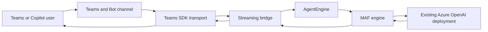

# Community Sample: Teams SDK + Microsoft Agent Framework Streaming

This community-maintained Python sample streams native Microsoft Agent Framework (MAF) updates through the Microsoft Teams SDK to:

- Microsoft Teams personal chat
- Microsoft 365 Copilot Chat as a custom engine agent

The sample deploys no Microsoft Foundry project, Foundry hosted agent, or Copilot Studio runtime. Its reference engine calls an existing Azure OpenAI deployment directly with Microsoft Entra authentication.

> This repository is not an official Microsoft product or supported Microsoft sample. It is a deployable pilot, not a production SLA.

## What this proves

- MAF produces real incremental updates with `agent.run(..., stream=True)`.
- Teams SDK owns the Teams/Copilot transport and streaming response.
- Teams SDK shows host-native progress before the first model update.
- The final stream uses an AI-generated message envelope so Copilot renders the accumulated text.
- `/approval-demo` provides one-time Approve/Reject human review backed by durable Azure state.
- `/image-demo` creates a deterministic PNG, stores it in private Blob Storage, and renders it through an expiring Adaptive Card URL.
- Teams personal chat analyzes one direct JPEG or PNG upload without a slash command, bounded to 10 MiB.
- `AgentEngine` keeps provider code outside the transport layer.
- Azure runtime calls Azure OpenAI without an API key or bot client secret.
- Delegated Microsoft Graph access is isolated behind the `/whoami` SSO flow.
- A single Microsoft 365 app package targets `personal` and `copilot` scopes.

What it does not claim:

- `fake-cortex` proves the adapter boundary only. It is not a Snowflake Cortex implementation.
- Passwordless runtime does not make SSO completely secretless. Azure Bot OAuth stores a rotating Entra credential for delegated Graph token exchange.
- Azure Bot does not remove Teams service throttles. Capacity testing and retry policy remain production work.
- Microsoft 365 supports files broadly, but custom-engine agent chats in Microsoft 365 Copilot currently don't support user file upload or agent-returned downloads.
- The Teams image-analysis slice normalizes JPEG/PNG input in bounded process memory and sends the metadata-free normalized image to Azure OpenAI through MAF. It doesn't persist uploads, scan for malware, support documents, guarantee OCR, or identify people.

## Architecture



MAF is one engine behind the protocol, not the application boundary. See [Architecture](docs/architecture.md) and [Replace the engine](docs/engines.md).

## Local demo in five minutes

Prerequisites:

- Python 3.11, 3.12, or 3.13
- [uv](https://docs.astral.sh/uv/)
- Node.js 24 or newer for Microsoft 365 Agents Playground

Install the locked Python environment and copy the local-only settings:

```bash
cp .env.example .env
uv sync --frozen
```

Start the app:

```bash
uv run python -m agent_app.main
```

In a second terminal, start the official local emulator:

```bash
npx -y @microsoft/m365agentsplayground@0.2.27 \
	-e http://localhost:3978/api/messages \
	-c emulator
```

Open `http://localhost:56150`, send `hello`, and expect:

```text
Demo engine: hello
```

The example sets `TEAMS_SKIP_AUTH=true`, but configuration rejects that value for every engine except `demo`. Never disable Teams authentication in Azure.

Send `/approval-demo` in Agents Playground to render a deterministic approval card. Azure deployment stores approval state in Table Storage; local demo state is process-local and intended only for development.

Send `/image-demo` to render a deterministic deployment snapshot. It is not an AI-generated image and contains no prompt, user, tenant, or subscription data.

## Verify the repository

```bash
uv sync --frozen
uv run pytest -q
uv run ruff check .
uv run pyright
az bicep build --file infra/main.bicep --stdout >/dev/null
bash -n scripts/*.sh
```

The Azure integration test is opt-in because it calls a real model deployment:

```bash
RUN_AZURE_INTEGRATION=1 \
ENGINE=maf \
AZURE_OPENAI_ENDPOINT=https://YOUR-RESOURCE.openai.azure.com/ \
AZURE_OPENAI_MODEL=YOUR-DEPLOYMENT \
uv run pytest tests/integration/test_azure_openai_stream.py -q
```

`DefaultAzureCredential` uses your local Azure identity for this test. No model API key is accepted by configuration.

## Deploy the pilot

The deployment creates Azure Container Apps, Azure Container Registry, Log Analytics, and Application Insights. Teams Developer CLI owns the Teams app, single-tenant Entra app, and Azure Bot registration. You provide an existing Azure OpenAI resource and model deployment.

Start with [Deploy to Azure](docs/deployment.md). That guide includes tenant policy, sideloading, Teams streaming, Copilot discovery, and `/whoami` acceptance steps.

## Documentation

| Guide                                                    | Purpose                                                               |
| -------------------------------------------------------- | --------------------------------------------------------------------- |
| [Architecture](docs/architecture.md)                     | Components, identities, streaming, SSO, and trust boundaries          |
| [Deploy to Azure](docs/deployment.md)                    | Prerequisites, deployment, Teams/Copilot installation, and acceptance |
| [Replace the engine](docs/engines.md)                    | Implement a Cortex-compatible or other provider adapter               |
| [Operations](docs/operations.md)                         | Health, telemetry audit, rollback, OAuth rotation, and cleanup        |
| [Security, cost, and scale](docs/security-cost-scale.md) | Honest controls, remaining risks, cost drivers, and throttles         |
| [Troubleshooting](docs/troubleshooting.md)               | Common local, Azure, Teams, Copilot, SSO, and streaming failures      |
| [Validation](docs/validation.md)                         | Reproducible gates, tenant acceptance, and primary references         |

## Repository map

```text
appPackage/                  Microsoft 365 app manifest template and icons
infra/                       Azure Bicep and cross-resource-group RBAC module
scripts/                     Deploy, SSO, package, smoke, audit, rotate, rollback
src/agent_app/engines/       Provider-neutral contract and engine adapters
src/agent_app/file_attachments.py
src/agent_app/stream_bridge.py
src/agent_app/teams_app.py   Teams/Copilot routes, streaming, and /whoami
tests/                       Unit, contract, infrastructure, and opt-in live tests
```

Generated app packages, deployment state, OAuth credential metadata, and local evidence are ignored by Git. Do not commit `.env`, `.local/`, `dist/`, or secrets.

## Contributing, security, and support

- Read [CONTRIBUTING.md](CONTRIBUTING.md) before proposing a change.
- Report vulnerabilities privately according to [SECURITY.md](SECURITY.md).
- Use [SUPPORT.md](SUPPORT.md) for usage and product-support boundaries.
- Participation is governed by this project's [Code of Conduct](CODE_OF_CONDUCT.md).

## License

This project is licensed under the [MIT License](LICENSE). See [NOTICE.md](NOTICE.md) and [THIRD_PARTY_NOTICES.md](THIRD_PARTY_NOTICES.md) for additional notices.
