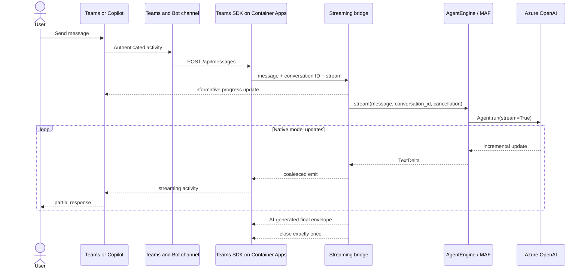
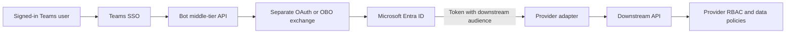
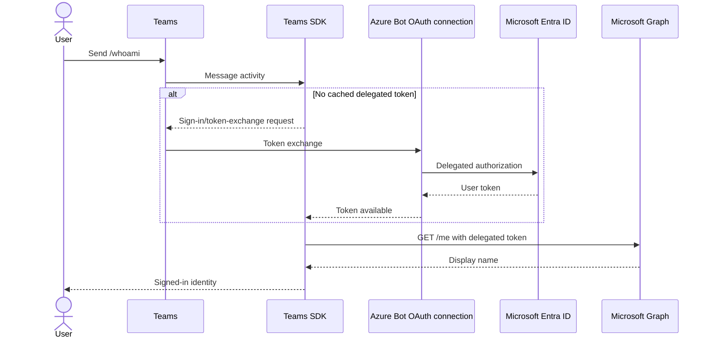
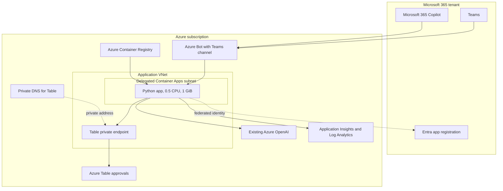

# Architecture

## Decision summary

This sample separates Microsoft 365 transport from model orchestration:

- Microsoft Teams SDK receives activities, performs bot/user authentication, and streams responses.
- `stream_bridge.py` translates provider-neutral text deltas into the Teams stream lifecycle.
- `AgentEngine` is the only contract the transport knows.
- Microsoft Agent Framework is the reference engine.
- An existing Azure OpenAI deployment is the reference model endpoint.

There is no Microsoft Foundry project, Foundry hosted agent, or Copilot Studio runtime in the request path. MAF runs inside the Container App process.

## Runtime flow



The bridge starts with `stream.update("Preparing response...")`. Microsoft 365 Copilot can replace that text with host-owned copy, but it renders native progress before response streaming begins. The bridge then coalesces adjacent deltas for 1-2 seconds and spaces the final close after the last update. This follows Teams guidance to avoid bursty streaming requests.

Before closing, the bridge emits `MessageActivityInput().add_ai_generated()` as the final activity envelope. `HttpStream` keeps the accumulated text and applies the AI metadata to the final message. Without this envelope, the channel accepted and completed turns but Microsoft 365 Copilot rendered empty response cards. The bridge never manufactures streaming by splitting a completed response.

The bridge cancels the engine and closes the sink when the channel reports Stop/cancellation. That code path is covered by contract tests. In the verified Microsoft 365 Copilot host, however, the pre-token Stop control disappeared when partial text began and a pre-token click did not produce a channel cancellation signal; the backend completed the turn. Host-to-bot cancellation therefore remains an acceptance limitation, not a completed capability.

## Engine boundary

`src/agent_app/engines/base.py` defines the complete provider contract:

```python
class AgentEngine(Protocol):
    def stream(
        self,
        message: str,
        conversation_id: str,
        cancellation: CancellationSignal,
    ) -> AsyncIterator[TextDelta]: ...
```

The transport does not import MAF, Azure OpenAI, Snowflake, or provider response types. Each adapter must:

1. Start a genuinely streaming provider operation.
2. Emit only new, non-overlapping text.
3. Stop promptly after cancellation.
4. Translate provider failures to a stable `EngineError` code.
5. Close any client or credential it owns.

See [Replace the engine](engines.md).

## Identity model

Three identities have different jobs:

| Identity                      | Used for                                                                 | Storage                                                   |
| ----------------------------- | ------------------------------------------------------------------------ | --------------------------------------------------------- |
| Deployment operator           | Azure deployment, role assignments, Entra and Teams administration       | Local Azure CLI and Teams CLI sessions                    |
| Container App system identity | ACR pull, direct Azure OpenAI call, federated bot runtime authentication | Azure managed identity; no client secret in the container |
| Signed-in Teams user          | Delegated `User.Read` for `/whoami`                                      | Azure Bot token service/OAuth connection                  |

The Container App system identity is granted `AcrPull` and `Cognitive Services OpenAI User`. A federated identity credential lets that managed identity act as the bot application, with `MANAGED_IDENTITY_CLIENT_ID=system` and no `CLIENT_SECRET`.

The Graph flow is separate. The app registration exposes `access_as_user`, preauthorizes Teams clients, and requests only delegated `User.Read`. Azure Bot OAuth still requires an Entra application credential. Scripts create and rotate that credential without writing its value to repository or deployment state.

### Delegating user identity to another provider

The current OAuth connection ends at Microsoft Graph. Its delegated access token is issued for the Microsoft Graph audience and must not be sent to Snowflake Cortex or another API. Microsoft documents that an API must accept only tokens whose `aud` claim identifies that API; accepting a token issued for another resource creates a confused-deputy risk. The Graph token also cannot be reused as the user assertion for another OBO exchange because an OBO assertion must target the middle-tier application performing the exchange.

A real downstream adapter that preserves the signed-in user identity needs a separate authorization path:

1. Teams obtains an access token for the bot's middle-tier API.
2. A confidential token-exchange component obtains a new delegated token for the downstream API, or the provider-specific OAuth flow issues that token directly.
3. The downstream API validates the token issuer, audience, tenant, user, and authorized client.
4. The adapter sends the downstream token only as a transport credential. It never places bearer tokens or identity claims in a model prompt, tool argument, log, or telemetry field.
5. The downstream data platform enforces authorization. The model must not decide which data a user may access.



For Snowflake Cortex, [External OAuth with Microsoft Entra ID](https://docs.snowflake.com/en/user-guide/oauth-azure) lets Snowflake validate an Entra token and map an `email` or `upn` claim to a Snowflake user. [Microsoft Entra SCIM provisioning](https://docs.snowflake.com/en/user-guide/scim-azure) can synchronize Entra users and groups to Snowflake users and roles. These are separate concerns: External OAuth authenticates a session, while SCIM provisions identities and role membership.

For example, an Entra group can map to a least-privileged Snowflake role such as `CORTEX_VIEW_BC_READER`, which is then configured as the user's default role for this integration. Snowflake documents that calling an agent requires the `SNOWFLAKE.CORTEX_USER` or `SNOWFLAKE.CORTEX_AGENT_USER` database role, privileges on the agent object, and privileges on objects used by the agent's tools. Cortex Agents derives session permissions from the querying user's default role. Grant that role `USAGE` on the containing database and schema and `SELECT` only on Views B and C. The agent cannot query View D or underlying tables unless the default role inherits access to them. Row access and masking policies remain necessary when users with the same role need different row or column visibility.

This repository does not implement that flow. The `graph` OAuth connection requests only `User.Read`, and `fake-cortex` is a deterministic contract adapter with no Snowflake call. A real implementation must add a downstream-specific OAuth path and Snowflake security configuration without weakening the existing bot or Graph trust boundaries. See [Microsoft identity platform OBO](https://learn.microsoft.com/entra/identity-platform/v2-oauth2-on-behalf-of-flow), [Cortex Agents access control](https://docs.snowflake.com/en/user-guide/snowflake-cortex/cortex-agents), and [Replace the engine](engines.md#delegated-user-authorization-for-cortex).

## Human approval flow

`/approval-demo` proves a cross-host human-in-the-loop boundary without allowing the model to execute arbitrary actions:

1. The app stores an opaque pending approval before sending the card.
2. The card carries only an approval ID and an Approve or Reject decision.
3. The action handler reloads server-side action metadata, binds the request to the originating actor and conversation, checks expiry, and conditionally replaces the entity using its ETag.
4. Exactly one click wins across replicas. Replays and stale-card clicks don't execute.
5. Every `Action.Execute` outcome returns a replacement card. This includes expired, forbidden, replayed, malformed, and storage-error outcomes, because message-only action responses can surface as transport errors in Microsoft 365 Copilot.
6. The app sends a permanent follow-up result because Copilot doesn't reliably persist refreshed Action.Execute cards after a chat is reopened.

Azure Table Storage holds pseudonymous hashes, fixed action metadata, status, timestamps, and ETag. The Container App uses managed identity with `Storage Table Data Contributor` scoped to the single `approvals` table. Shared-key authentication is disabled.

## Teams file intake

Direct upload is an attachment-first Teams personal-chat path; it does not use a slash command:

1. The user attaches one file in the personal chat and sends the message with or without a caption.
2. Teams stores the file in the user's OneDrive for Business and sends a `application/vnd.microsoft.teams.file.download.info` attachment.
3. The app validates the attachment type, filename, and HTTPS download URL.
4. The runtime-owned HTTP client rejects redirects and reads at most `FILE_UPLOAD_MAX_BYTES`, including when `Content-Length` is absent or incorrect.
5. JPEG/PNG input is signature-checked, decoded under a 20-megapixel guard, EXIF-oriented, converted to RGB, resized to a 1024-pixel maximum edge, and re-encoded without source metadata.
6. `MafEngine` sends a user `Message` containing the caption/default instruction and `Content.from_data(...)` image through native MAF streaming.
7. The existing stream bridge owns progress, coalescing, cancellation, final AI metadata, telemetry outcome, and close.

`AgentEngine` remains text-only; `ImageAnalysisEngine` is a separate provider-neutral boundary. Source and normalized bytes remain process-local and aren't persisted or logged. Azure OpenAI receives the normalized JPEG and instruction under tenant model-service policy. Text visible inside an image is untrusted model input and can't override system instructions. Microsoft 365 Copilot custom-engine chats don't deliver file attachments to this path.

## SSO flow



SSO cannot be validated in Agents Playground. Microsoft documents that user authentication must be tested in Teams.

## Deployment topology



Ingress is public HTTPS because the Teams channel must reach `/api/messages`. Application authentication remains enabled in Azure. The Container Apps environment is VNet-integrated, while the Storage Table public endpoint is disabled and reached through a private endpoint and private DNS. Health endpoints and the manifest website/legal routes do not call the model, Graph, or Table Storage.

## State and persistence

The chat path is turn-stateless, while approvals use narrow durable state:

- No chat transcript database is provisioned.
- The MAF adapter currently ignores `conversation_id` for model memory.
- Message content is passed to the selected provider but is not persisted by application code.
- Teams source bytes are held only for the bounded request. A metadata-free, normalized JPEG is passed to the configured provider for image analysis and is not persisted by application code.
- Telemetry records allowlisted operational values, delta counts, timings, outcomes, and a process-local keyed hash of conversation ID.
- Approval entities persist opaque IDs, pseudonymous actor/conversation hashes, fixed action metadata, status, timestamps, and ETags in one Azure Table.

Add an external store only when a real requirement exists for threads, resumability, audit, or cross-replica coordination. Treat that as a new privacy and retention boundary.
